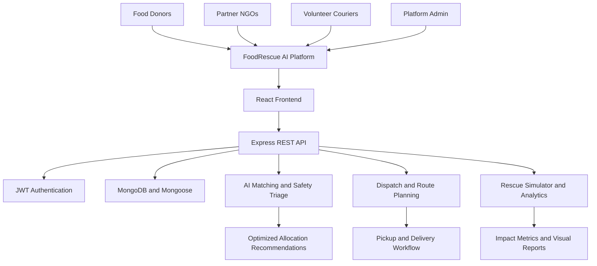

# 🌿 FoodRescue AI
### AI-Powered Food Rescue & Smart Distribution Network

<p align="center">
  <strong>Rescue Food. Reduce Waste. Feed Communities.</strong>
  <br />
  Turning surplus food into meaningful impact through explainable AI, intelligent matching, and real-time rescue coordination.
</p>

<p align="center">
  
  
  
  
</p>

<p align="center">
  <a href="#-overview">Overview</a> •
  <a href="#-key-features">Features</a> •
  <a href="#-technology-stack">Tech Stack</a> •
  <a href="#-getting-started">Installation</a> •
  <a href="#-demo-accounts">Demo Accounts</a> •
  <a href="#-api-reference">API Reference</a>
</p>

---

## 🌍 The Problem We're Solving

Every day, restaurants, hotels, caterers, and institutional kitchens generate surplus food, while shelters and underserved communities struggle to access sufficient meals.

The problem isn't always a lack of food. It's the lack of **coordination, visibility, and timely distribution**.

FoodRescue AI bridges this gap by connecting food donors, partner NGOs, and volunteer couriers through an intelligent food rescue network.

### 💡 Our Mission

- 🍱 **Rescue surplus food** before it becomes waste.
- 🤝 **Connect donors with NGOs** based on demand, distance, and food compatibility.
- 🚚 **Coordinate volunteers** for efficient pickup and delivery.
- 🧠 **Use explainable AI** to prioritize donations and recommend better matches.
- 🌱 **Measure impact** through food recovery, waste reduction, and estimated carbon savings.

> Food that could go to waste should have a chance to become someone's next meal.

---

## ✨ Key Features

### 🎯 1. Multi-Role Platform

A unified ecosystem designed for every participant in the food rescue process.

| Role | Capabilities |
|---|---|
| 🏪 Donor | Publish surplus food batches, set consumption deadlines, and track pickups. |
| 🏠 NGO | Manage meal capacity, specify dietary preferences, and claim suitable donations. |
| 🛵 Volunteer | Accept assignments and progress through pickup and delivery stages. |
| 🛡️ Admin | Monitor network activity, inspect analytics, and run rescue simulations. |

**Instant Demo Mode:** Switch between role perspectives during a presentation to demonstrate the entire workflow without repeatedly signing in.

### 🧠 2. Explainable AI Matching Engine

FoodRescue AI uses a weighted scoring algorithm to recommend suitable NGOs for every donation.

| Matching factor | Weight |
|---|---:|
| 📍 Geographic proximity | 30% |
| 🍱 Quantity and capacity fit | 25% |
| 🥗 Food category compatibility | 20% |
| ⭐ Reliability score | 15% |
| ⏳ Time sensitivity | 10% |

Each recommendation can include a match percentage and human-readable explanations, helping users understand why a particular NGO was selected.

**The goal:** Make smarter allocation decisions without treating AI recommendations as unexplained black boxes.

### 🚨 3. Intelligent Food Safety & Urgency Triage

Donations are classified according to their remaining time window.

| Priority | Remaining time | Recommended attention |
|---|---|---|
| 🔴 Critical | Under 3 hours | Immediate assessment and dispatch |
| 🟠 High | 3–6 hours | Prioritized matching and pickup |
| 🟡 Medium | 6–12 hours | Timely allocation |
| 🟢 Low | Over 12 hours | Standard allocation workflow |

The system is designed to prioritize urgent donations while accounting for food safety constraints.

**Safety first:** Urgency labels do not guarantee that food is safe to consume. Actual acceptance must consider food type, storage conditions, preparation time, applicable safety requirements, and the verified consumption deadline.

### 🚚 4. Smart Volunteer Dispatch

Recommend suitable couriers using multiple operational factors:

- Distance to the pickup location.
- Available vehicle capacity.
- Current assignments and workload.
- Volunteer availability.
- Historical performance rating.

The dispatch workflow follows:

`Assigned → Accepted → Picked Up → Delivered`

This creates a clear operational lifecycle for each rescue mission.

### 🛡️ 5. Duplicate Donation Shield

Reduce accidental duplicate submissions by identifying potentially similar donations using factors such as:

- Donor identity.
- Location.
- Food category and quantity.
- Submission time window.

Potential duplicates can be flagged for review before creating unnecessary rescue missions.

### 📈 6. Food Demand Forecasting

Explore estimated surplus-food and shelter-demand patterns over a seven-day horizon.

The forecasting module is designed to help identify:

- Expected demand surges.
- Potential food shortages.
- Excess supply across locations.
- Opportunities for improved allocation.

Forecast accuracy depends on the quality and availability of historical data.

### 🗺️ 7. Interactive Rescue Map

Visualize the food rescue network using Leaflet and OpenStreetMap.

- 🏪 Donor locations.
- 🏠 Partner NGO locations.
- 🛵 Volunteer locations.
- 🚨 Urgent donation markers.
- 🛣️ Active route polylines.
- 🔎 Layer-based map filtering.
- 📍 Interactive markers and quick-action popups.

The map provides a geographic view of the network, making it easier to understand where food is available and where it needs to go.

### 🔥 8. Food Rescue Simulator — Our Flagship Feature

An interactive simulation environment for testing different food rescue scenarios.

Configure the network using dynamic controls:

| Parameter | Supported range |
|---|---:|
| Surplus meals | 100–5,000 |
| Partner NGOs | 2–30 |
| Volunteers | 2–50 |
| Donor hubs | 1–15 |
| Rescue radius | 2–30 km |

#### ⚡ Five-stage simulation pipeline

1. **Ingestion & Validation** — Process surplus food and network inputs.
2. **Safety & Priority Triage** — Classify donations by urgency and eligibility.
3. **AI Matching** — Allocate suitable donations to partner NGOs.
4. **Volunteer Dispatch & Routing** — Assign couriers and optimize trips.
5. **Impact Analysis** — Evaluate allocations, bottlenecks, and estimated savings.

#### 📊 Simulation outputs

- Meal allocation breakdown.
- Unallocated and potentially wasted meals.
- Volunteer assignment and trip estimates.
- Baseline-versus-simulated waste reduction.
- Estimated CO₂ emissions avoided.
- Bottleneck diagnostics.
- Searchable dispatch ledger.
- Interactive charts powered by Recharts.

The simulator is designed to make the benefits and trade-offs of intelligent food distribution visible and understandable.

*Simulation results are model-generated estimates, not proof of actual food delivery or independently verified environmental savings.*

---

## 🛠️ Technology Stack

<table>
  <tr>
    <td width="50%">
      <h3>🎨 Frontend</h3>
      <ul>
        <li>React.js</li>
        <li>Vite</li>
        <li>Tailwind CSS</li>
        <li>React Router DOM</li>
        <li>Axios</li>
        <li>Recharts</li>
        <li>Leaflet & React-Leaflet</li>
        <li>Lucide React</li>
        <li>Canvas Confetti</li>
      </ul>
    </td>
    <td width="50%">
      <h3>⚙️ Backend</h3>
      <ul>
        <li>Node.js</li>
        <li>Express.js</li>
        <li>MongoDB</li>
        <li>Mongoose</li>
        <li>JWT Authentication</li>
        <li>bcryptjs</li>
        <li>CORS</li>
        <li>dotenv</li>
        <li>REST API Architecture</li>
      </ul>
    </td>
  </tr>
</table>

### 🧩 Architecture Highlights

- **Context-based state management:** Authentication, application data, and notifications.
- **RESTful API:** Separation of frontend presentation and backend business logic.
- **Explainable algorithms:** Transparent weighted matching and dispatch recommendations.
- **Hybrid demo resilience:** Client-side mock data can support demonstrations when the database or backend is unavailable, where implemented.
- **Modular structure:** Separate components, pages, controllers, routes, models, and utility functions.

---

## 🏗️ System Architecture



---

## 📂 Project Structure

```text
FoodRescue-AI/
│
├── frontend/
│   ├── public/
│   └── src/
│       ├── components/
│       │   ├── common/
│       │   ├── landing/
│       │   ├── donations/
│       │   ├── ai/
│       │   ├── map/
│       │   └── simulator/
│       │
│       ├── context/
│       ├── pages/
│       ├── services/
│       │   ├── api.js
│       │   └── mockData.js
│       ├── utils/
│       │   └── aiAlgorithms.js
│       ├── App.jsx
│       ├── main.jsx
│       └── index.css
│
├── backend/
│   ├── config/
│   │   └── db.js
│   ├── controllers/
│   ├── middleware/
│   ├── models/
│   ├── routes/
│   ├── seed/
│   │   ├── seedData.js
│   │   └── seedRunner.js
│   ├── server.js
│   ├── .env.example
│   └── package.json
│
├── package.json
└── README.md
```

*Note: The structure above represents the intended project organization. Adjust filenames and folders to match the actual repository.*

---

## 🚀 Getting Started

Follow these steps to run FoodRescue AI locally.

### Prerequisites

Make sure you have installed:

- [Node.js](https://nodejs.org/) v18 or higher.
- npm.
- MongoDB locally or a MongoDB Atlas connection, if using persistent database functionality.
- Git.

### 1. Clone the repository

```bash
git clone <YOUR_GITHUB_REPOSITORY_URL>
cd FoodRescue-AI
```

Replace the repository URL with your actual GitHub repository URL.

### 2. Install dependencies

If the root `package.json` defines the `install:all` script:

```bash
npm run install:all
```

Alternatively, install each application separately:

```bash
cd frontend
npm install

cd ../backend
npm install

cd ..
```

### 3. Configure environment variables

Create a `.env` file inside the `backend/` directory using `.env.example` as your reference.

Example configuration:

```env
PORT=5000
MONGODB_URI=mongodb://127.0.0.1:27017/foodrescue_ai
JWT_SECRET=replace_with_a_strong_random_secret
NODE_ENV=development
```

Update `MONGODB_URI` if you use MongoDB Atlas.

**Important:** Use a strong secret for `JWT_SECRET`. Never commit real credentials or secret environment files to GitHub.

Ensure the backend configuration reads the same environment variable names.

### 4. Seed demo data (optional)

If your project includes a database seed script and MongoDB is running:

```bash
npm run seed
```

Run this command from the project root, where the corresponding script is configured.

### 5. Start the application

If the root `package.json` defines the `dev` script for both services:

```bash
npm run dev
```

Otherwise, run the backend and frontend in separate terminals.

**Terminal 1 — Backend**

```bash
cd backend
npm run dev
```

**Terminal 2 — Frontend**

```bash
cd frontend
npm run dev
```

### 6. Open the application

| Service | Local URL |
|---|---|
| Frontend | http://localhost:5173 |
| Backend | http://localhost:5000 |

Make sure the frontend API configuration points to the correct backend URL.

---

## 🔐 Demo Accounts

Use these sample accounts to explore the different platform perspectives, provided the accounts are seeded or otherwise configured in your environment.

| Role | Organization / User | Email | Password |
|---|---|---|---|
| 🏪 Donor | Green Feast Caterers | `donor@foodrescue.ai` | `password123` |
| 🏠 NGO | Hope Food Shelter | `ngo@foodrescue.ai` | `password123` |
| 🛵 Volunteer | Alex Rivera | `volunteer@foodrescue.ai` | `password123` |
| 🛡️ Admin | System Administrator | `admin@foodrescue.ai` | `password123` |

**Demo tip:** Use the role switcher to demonstrate how a single donation moves through the ecosystem, from publication to NGO allocation and volunteer delivery.

> These are demonstration credentials only. Do not use them for production deployments or expose real administrative accounts publicly.

---

## 📡 API Reference

Base URL for local development:

```text
http://localhost:5000/api
```

### 🔑 Authentication

| Method | Endpoint | Description |
|---|---|---|
| POST | `/auth/register` | Register a user with a specified role. |
| POST | `/auth/login` | Authenticate and receive a JWT. |

### 🍱 Donations

| Method | Endpoint | Description |
|---|---|---|
| GET | `/donations` | Retrieve donations with supported filters. |
| POST | `/donations` | Create a surplus food donation. |
| GET | `/donations/:id/matches` | Retrieve the top NGO matches for a donation. |

### 🏠 NGOs

| Method | Endpoint | Description |
|---|---|---|
| GET | `/ngos` | Retrieve partner NGOs and receiving capacity. |
| POST | `/ngos/requirements` | Update food demand and preferred rescue radius. |

### 🛵 Volunteers & Deliveries

| Method | Endpoint | Description |
|---|---|---|
| GET | `/volunteers` | Retrieve the volunteer roster. |
| PUT | `/volunteers/availability` | Update volunteer availability. |
| GET | `/deliveries` | Retrieve rescue missions. |
| POST | `/deliveries/assign` | Assign a courier to a rescue mission. |
| PUT | `/deliveries/:id/status` | Update the delivery lifecycle status. |

### 📊 Simulation & Analytics

| Method | Endpoint | Description |
|---|---|---|
| POST | `/simulator/run` | Execute a rescue simulation. |
| GET | `/analytics/summary` | Retrieve community impact metrics. |

*API availability, request schemas, authorization requirements, and response formats depend on the actual backend implementation.*

---

## 🧠 How the AI Matching Score Works

The matching engine combines multiple factors into a weighted recommendation score.

For an NGO candidate \(n\):

\[
\begin{aligned}
S(n) ={}& 0.30P(n) + 0.25Q(n)\\
&+ 0.20C(n) + 0.15R(n)\\
&+ 0.10U(n)
\end{aligned}
\]

Where:

- \(P(n)\) = proximity score.
- \(Q(n)\) = quantity and capacity fit.
- \(C(n)\) = food category compatibility.
- \(R(n)\) = reliability score.
- \(U(n)\) = urgency-related suitability score.

Each factor should be normalized to a common scale, such as 0–100, before applying the weights.

The final score supports ranking and comparison. It should not override food safety rules, dietary restrictions, geographic constraints, or actual NGO capacity.

### 🚦 Design Principles

- **Explainability:** Show why a candidate is recommended.
- **Safety:** Exclude donations that fail mandatory safety checks.
- **Fairness:** Consider workload and reliability rather than repeatedly assigning every mission to the same courier.
- **Efficiency:** Reduce unnecessary travel and allocation mismatches.
- **Transparency:** Distinguish algorithmic estimates from verified real-world outcomes.

---

## 📈 Impact Metrics

FoodRescue AI is designed to help communities understand the operational impact of food rescue.

| Metric | Purpose |
|---|---|
| 🍱 Meals rescued | Measure food portions successfully recovered. |
| ♻️ Waste reduction | Compare simulated or observed waste against a defined baseline. |
| 🚚 Rescue trips | Measure courier deployment and delivery activity. |
| 🌍 Estimated CO₂ avoided | Estimate environmental benefits using documented assumptions. |
| 🏠 NGO fulfillment | Measure demand met against partner requirements. |
| ⏱️ Rescue completion time | Evaluate operational timeliness. |

Environmental calculations should use documented conversion factors, consistent measurement units, and clearly defined baselines. Actual delivered meals should be counted separately from simulated allocations.

---

## 🔒 Security & Reliability

FoodRescue AI is designed with the following engineering considerations:

- JWT-based authentication.
- Password hashing with bcryptjs.
- Role-based authorization for protected operations.
- Environment-based configuration.
- Input validation and centralized error handling.
- Database-backed persistence when MongoDB is available.
- Mock-data fallback for supported demo workflows.

**Production checklist:**

- Enforce authorization on the backend, not only in the UI.
- Restrict demo role switching to authorized demo environments.
- Never expose private keys or administrative credentials.
- Configure CORS for trusted origins.
- Validate donation, capacity, and delivery status updates.
- Add request throttling and security headers.
- Verify that fallback mode cannot silently imply real-world dispatches or successful deliveries.

---

## 🛣️ Roadmap

- [x] Multi-role platform concept.
- [x] Explainable weighted matching design.
- [x] Food urgency classification design.
- [x] Interactive rescue simulator concept.
- [x] Interactive map integration plan.
- [ ] Complete end-to-end donation lifecycle testing.
- [ ] Validate duplicate detection against real submissions.
- [ ] Improve route optimization with real routing data.
- [ ] Evaluate demand forecasting against historical datasets.
- [ ] Add automated testing and CI workflows.
- [ ] Deploy the frontend and backend.
- [ ] Validate security, food safety, and production readiness.

*Update the checklist as features are implemented and verified.*

---

## 🤝 Contributing

Contributions are welcome! Whether you're improving the matching algorithm, refining the interface, or building better routing logic, your ideas can help make food rescue more effective.

1. Fork the repository.
2. Create a feature branch.

   ```bash
   git checkout -b feature/your-feature-name
   ```

3. Make your changes and test them.
4. Commit with a clear message.

   ```bash
   git add .
   git commit -m "feat: add your feature"
   ```

5. Push your branch.

   ```bash
   git push origin feature/your-feature-name
   ```

6. Open a Pull Request with a clear description of your changes.

### Contribution Guidelines

- Follow the existing project structure and coding conventions.
- Keep changes focused and maintainable.
- Test relevant user workflows.
- Never commit `.env` files, passwords, or API secrets.
- Document changes to API endpoints and configuration.

---

## 👥 Team

**Built with the vision of making food distribution smarter, faster, and more accessible.**

- **Project:** FoodRescue AI
- **Category:** Social Impact • Artificial Intelligence • Full-Stack Development
- **Core focus:** Food waste reduction, intelligent resource allocation, and community support.

Add your team members, GitHub profiles, and project mentor here.

---

## 📄 License

This project is intended for educational, demonstration, and social-impact development.

Add a `LICENSE` file to the repository to specify the terms under which others may use, modify, and distribute the project.

---

<p align="center">
  <strong>🌿 Every Meal Matters. Every Rescue Counts.</strong>
  <br />
  <em>Let's turn surplus into sustenance — one rescue at a time.</em>
</p>

<p align="center">
  Made with ❤️ for communities, powered by technology.
</p>
